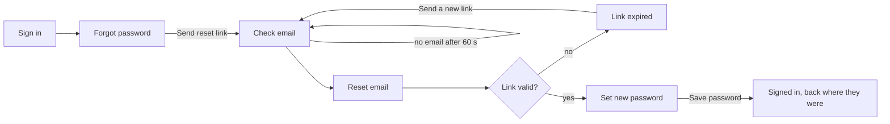
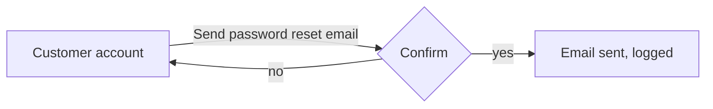

# Workflows: Forgot password

## F-01 · Reset by email
- Based on: Forgot password → email → reset → signed in (`common-flows.md`, `patterns/auth.md`)
- Trigger: "Forgot password?" on Sign in (also at checkout)
- Actors: Shopper, Loyal customer
- Extends: Sign in (failure path) in `eggux/workflows.md`
- Scenarios: S-01, S-02, E-01 to E-05

| # | Actor | Step | Screen | Object and CTA | Next |
|---|---|---|---|---|---|
| 1 | Shopper | Taps "Forgot password?" | Sign in | | 2 |
| 2 | Shopper | Enters or confirms email, taps "Send reset link" | Forgot password | Customer account · request reset | 3 |
| 3 | System | Same response for any email; sends the email only if an account exists | Check email | Reset link · create | 4 |
| 4 | Shopper | Decision: email arrived? | Check email | | yes → 5, no → resend (E-03) |
| 5 | Shopper | Opens the link | Reset email | | 6 |
| 6 | System | Decision: link valid? | | Reset link · check | yes → 7, no → Link expired (E-02) |
| 7 | Shopper | Sets a new password, taps "Save password" | Set new password | Customer account · reset password | signed in, back where they were |

## F-02 · Support sends a reset email
- Based on: custom
- Trigger: a customer asks support for help signing in
- Actors: Support agent
- Extends: new
- Scenarios: S-03

| # | Actor | Step | Screen | Object and CTA | Next |
|---|---|---|---|---|---|
| 1 | Agent | Opens the customer's account | Admin: customer account | | 2 |
| 2 | Agent | "Send password reset email", confirms | Admin: customer account | Customer account · send reset email | F-01 step 4 for the customer |

