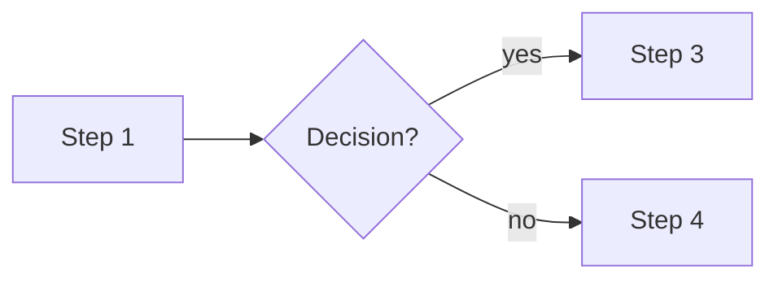

# Workflows: {{name}}

The user flows of this feature. Each flow has a frame `Flow / <ID> <name>` in the Flows section
of the feature's Figma page. A flow that adds to or changes a product workflow is also merged
into `eggux/workflows.md` (see "Extends").

## F-01 · {{flow name}}
- Based on: common flow (`common-flows.md`) or custom
- Trigger: user action, schedule or event
- Actors:
- Extends: workflow in `eggux/workflows.md`, or new
- Scenarios: S-01, E-01

| # | Actor | Step | Screen | Object and CTA | Next |
|---|---|---|---|---|---|
| 1 | | | | | 2 |
| 2 | | Decision: … ? | | | yes → 3, no → 4 |

